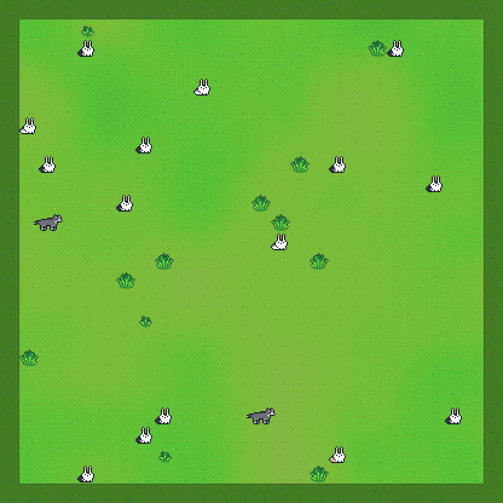
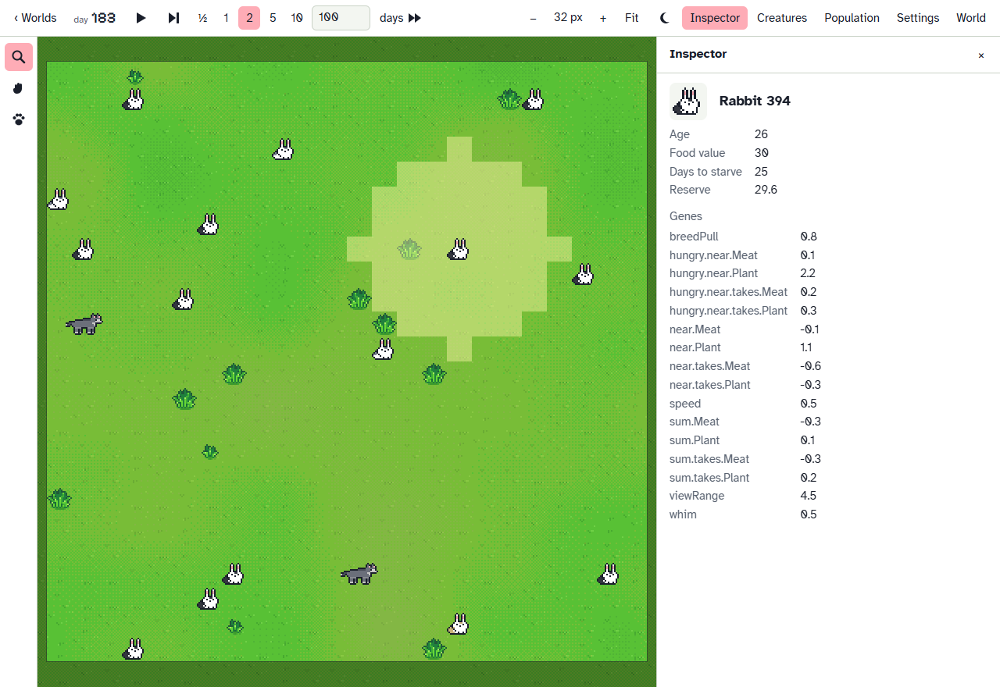
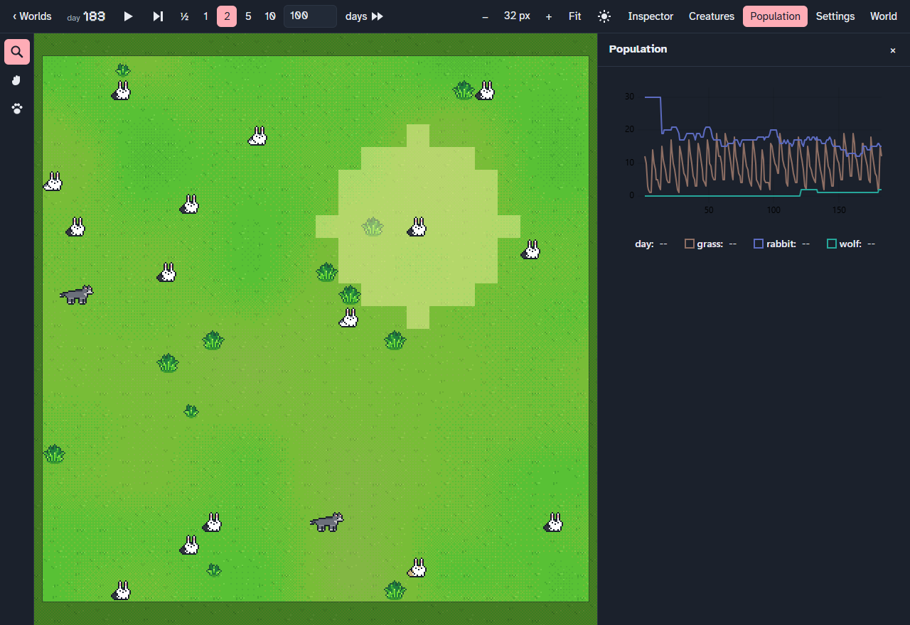

# EvolutionSimulation

A small world where creatures evolve by natural selection, and you watch it
happen in your browser.

## How it works

- Every creature carries genes that decide how it behaves: how strongly it is
  drawn to food, how far it sees, how fast it moves, how much it avoids others.
- A creature that eats well lives long enough to breed. Its children inherit
  its genes with small random changes.
- Nothing scores the creatures and nothing picks the winners. The survivors
  leave more children, so the population drifts toward whatever works.
- Nobody tells a rabbit that wolves are dangerous. It only sees that something
  nearby eats meat, and with wolves around, rabbits evolve to keep their
  distance.

## What you can do

  
  

- Create worlds from a seed and play them at up to ten days a second, or
  fast-forward thousands of days.
- Click a creature to see its genes, its reserve and how far it sees.
- Chart each species' population over time.
- Drop in new creatures, or change any rule of the world with a slider while
  it runs.
- Turn mutation off and watch evolution stop.
- Replay any world exactly from its seed.
- Use it on a phone, in light or dark. The pixel art is drawn for the project,
  and a creature's markings follow its genes, so relatives look alike.

## Try it

You need Java 25. The build fetches Maven and Node itself.

    git clone https://github.com/DeCoppelElias/EvolutionSimulation.git
    cd EvolutionSimulation
    ./mvnw package
    java -jar target/EvolutionSimulation.jar serve

`serve` opens the page in your browser. Then:

1. Create a world and press play.
2. Open the World panel and spawn a few wolves.
3. Click a creature to inspect it.

Space plays and pauses, and plus and minus zoom.

## How a creature decides

Each day a creature scores every tile it could reach by what it sees there,
and moves to the best one. It sees features: `Plant` or `Meat` for food, and
`takes.Plant` or `takes.Meat` for something that eats it. Each feature has
three genes:

- `near.X` pulls toward the nearest one.
- `hungry.near.X` adds to that pull as the creature gets hungry.
- `sum.X` pulls by closeness to all of them.

Any pull can go negative. A rabbit flees wolves once `near.takes.Meat` drifts
below zero, and one whose `near.Plant` does the same walks away from food and
starves.

## For tinkerers

Everything below needs the jar from `./mvnw package`.

- `run` advances a world without a page and prints one JSON line per day, with
  each species' population, the mean of every gene and the deaths by cause.
  `--set`, `--set-at` and `--gene` change settings and starting genes,
  `--export` and `--spawn-from` carry evolved creatures into a new world, and
  `run --help` lists the rest.
- `tools/compare.py` runs variants of a world over many seeds in parallel and
  reports how each fared, with medians, effect sizes and Mann-Whitney tests.
- `tools/ancestor_competition.py` checks that evolution did something, by
  setting evolved rabbits against copies of their ancestors.
- `serve --no-browser --port 0` holds worlds behind a JSON API that scripts can
  drive: create, spawn, step, play, stream each day, change settings and read
  the command log. `serve --host 0.0.0.0` lets a phone on your network open the
  page.

The Python tools need only Python 3, and their presets live in
`tools/experiments/`.

    java -jar target/EvolutionSimulation.jar run --seed 1 --days 500 --spawn rabbit=40 --spawn wolf=6
    python tools/compare.py tools/experiments/fleeing.json
    curl -X POST localhost:PORT/worlds/ID/step -d '{"days":500}'

## Building

    ./mvnw verify                    compile, check formatting, run the tests
    ./mvnw verify -Pskip-frontend    the Java alone, serving the API without a page
    ./mvnw frontend:npm "-Dfrontend.npm.arguments=run dev"    the page with hot reload

The simulation is Java with Javalin, the page is React and TypeScript on a
canvas, and the art lives as text grids in `art/sprites.py`.

## Where it is going

- `DESIGN.md` describes what the world is meant to become.
- `docs/roadmap/` says how far it has got. Next come small effects for births,
  deaths and kills, then a hosted version anyone can open.
- `docs/adr/` says why it is shaped the way it is.

The project started in 2022 as HumanSimulation, a Swing app of humans looking
for food. That version is kept on the `v1.0-original-2022` tag.
